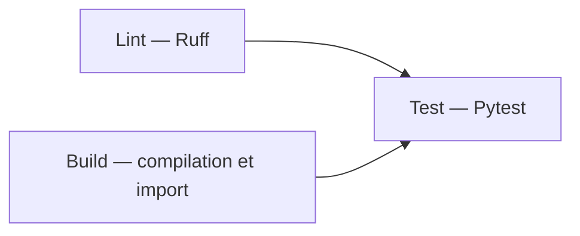

# TP5 — Construire un workflow CI avec GitHub Actions

Réalisé par Achibane Aya — compte GitHub `ashAya758jv`.

## Livrables

- [Fork du dépôt du professeur](https://github.com/ashAya758jv/python-fastapi-app).
- Branche : `feature/tp-ci`.
- [Pull request vers main du fork](https://github.com/ashAya758jv/python-fastapi-app/pull/1).
- [Run complet et vert : CI avec contextes sur push](https://github.com/ashAya758jv/python-fastapi-app/actions/runs/42835459768).
- [Run complet et vert : CI avec contextes sur PR](https://github.com/ashAya758jv/python-fastapi-app/actions/runs/42835475474).

Les deux runs ci-dessus correspondent au commit `6070da12e411e3648f0d4aa9fda58ddc751994f3`, qui contient l’implémentation finale des workflows et le correctif du test de configuration.

## Réponses Q0–Q10

**Q0.** Le code est dans [app/](app/), les tests dans [tests/](tests/) et les dépendances de développement dans [requirements-dev.txt](requirements-dev.txt). Le dossier [.github/](.github/) existe déjà avec [ci.yml](.github/workflows/ci.yml) ; les dépendances applicatives sont dans [requirements.txt](requirements.txt).

**Q1.** [01-filtres.yml](.github/workflows/01-filtres.yml) utilise `push.branches: [main, 'feature/**']` et `push.paths: ['app/**', 'tests/**']`. Pour les PR, `types: [opened, synchronize]` sélectionne leur ouverture et les mises à jour de la branche source.

**Q2.** Le push `7436e34`, limité au [README](README.md), ne déclenche pas Filtres, car aucun chemin sélectionné n’est modifié. Le push `5f2a490`, modifiant [app/main.py](app/main.py), déclenche [ce run réussi](https://github.com/ashAya758jv/python-fastapi-app/actions/runs/42834764568).

**Q3.** Entre les filtres `branches` et `paths`, la logique est **ET** : les deux doivent correspondre. Entre les types `opened` et `synchronize`, c’est **OU** ; les différents motifs d’une même liste positive sont aussi des alternatives.

**Q4.** [tag.yml](.github/workflows/tag.yml) utilise uniquement `on.push.tags: ['v*']`. Le tag `v1.0.0`, créé puis poussé avec `git push origin v1.0.0`, a déclenché [ce run vert](https://github.com/ashAya758jv/python-fastapi-app/actions/runs/42834923914).

**Q5.** [02-ci.yml](.github/workflows/02-ci.yml) lance `lint` et `build` en parallèle, puis `test` avec `needs: [lint, build]`. Chaque job effectue `actions/checkout@v4`, `actions/setup-python@v5` avec Python `3.13`, puis installe les deux fichiers de dépendances avant sa vérification.

**Q6.** Sans `needs`, les trois jobs ont démarré ensemble : environ **16 s** du premier démarrage à la dernière fin, contre **35 s** avec dépendances sur les runs observés. Avec `needs` rétabli et `import os` inutilisé, `lint` échoue, `build` réussit et `test` est **skipped** ; l’erreur est ensuite corrigée.

**Q7.** Chaque job sur `ubuntu-latest` dispose d’une machine isolée : ni le checkout ni l’environnement Python installé dans un autre job ne sont partagés. Le job `test` doit donc refaire le checkout, configurer Python et installer ses dépendances.

**Q8.** Dans [03-contextes.yml](.github/workflows/03-contextes.yml) : application `${{ env.APP_NAME }}`, acteur `${{ github.actor }}`, événement `${{ github.event_name }}`, branche `${{ github.ref_name }}`, commit `${{ github.sha }}` et OS `${{ runner.os }}`. `APP_NAME` vaut `fastapi-starter` et l’OS vaut `Linux`.

**Q9.** Sur push : `github.event_name=push`, `github.head_ref` et `github.base_ref` sont vides. Sur la PR n° 1 : `pull_request`, `head_ref=feature/tp-ci`, `base_ref=main` ; `github.ref_name` vaut `1/merge` et le SHA représente le commit de fusion de test.

**Q10.** Dans le JSON de `${{ toJson(github) }}` du run push, le message est sous `event.head_commit.message` : `ci(tp5): afficher les contextes push et PR avec APP_NAME`. Sur `pull_request`, ce champ propre au payload push est absent ; il ne faut pas le confondre avec le titre de la PR.

## Preuves des expériences Q6

| Expérience | Commit | Run | Résultat |
| --- | --- | --- | --- |
| Avec `needs` | `5f47fe7` | [CI](https://github.com/ashAya758jv/python-fastapi-app/actions/runs/42834936983) | lint et build à 14:31:30 UTC ; test de 14:31:50 à 14:32:05 UTC |
| Sans `needs` | `88c02c8` | [CI](https://github.com/ashAya758jv/python-fastapi-app/actions/runs/42835046656) | trois jobs à 14:32:08 UTC ; dernière fin à 14:32:24 UTC |
| Erreur Ruff volontaire | `34ee241` | [CI](https://github.com/ashAya758jv/python-fastapi-app/actions/runs/42835061147) | lint en échec ; build réussi ; test ignoré |
| Correction | `8a31b4e` | [CI](https://github.com/ashAya758jv/python-fastapi-app/actions/runs/42835073819) | trois jobs réussis, dépendances rétablies |

Horaires relevés le 10 novembre 2026 via l’API GitHub Actions. Les durées excluent l’attente avant le démarrage du premier job et dépendent de la disponibilité des runners.

## Validation et choix d’implémentation

- Validation locale sous Python 3.13.2 : `ruff check .` réussi, **18 tests réussis**, couverture **100 %** pour un seuil de 85 %, compilation et import de l’application réussis.
- Validation répétée avec `APP_NAME=fastapi-starter`, comme dans le workflow des contextes.
- Le test des valeurs par défaut dans [test_config.py](tests/test_config.py) retire les variables de configuration avec `monkeypatch` et utilise `Settings(_env_file=None)` pour tester réellement les valeurs par défaut, indépendamment de l’environnement CI.
- Les dépendances de développement ne comprennent pas les dépendances applicatives : les jobs installent donc `requirements.txt` **et** `requirements-dev.txt`.
- Le JSON demandé en Q10 est transmis à `echo` via la variable `GITHUB_CONTEXT`, alimentée par `${{ toJson(github) }}`. Cela affiche le contexte sans injecter les messages de commit directement dans le script shell ; le jeton GitHub est masqué par GitHub Actions.
- Chaque nouveau workflow a son propre commit et son push. L’étape 3 est conservée dans un nouveau fichier pour respecter la règle de travail du TP ; le workflow de l’étape 2 reste disponible.
- Un avertissement de dépréciation de Starlette concernant `httpx` apparaît localement ; il n’empêche aucun test de réussir.
